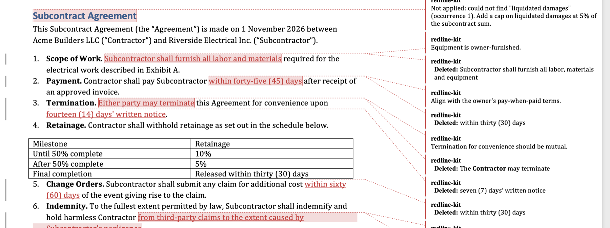
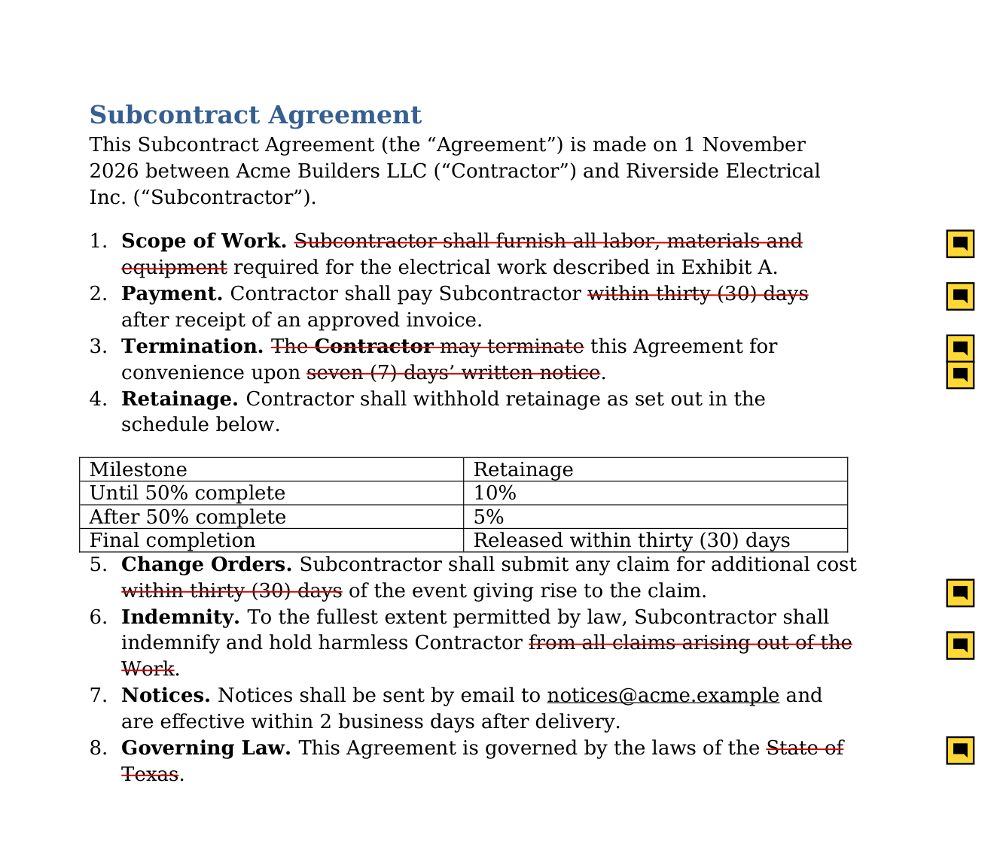

# redline-kit

Contract redlines that lawyers can actually use: native Word Track Changes and comments in an existing .docx, strikeouts and notes on a PDF, and a miner that reads redlines back out of both.

One JSON list of edits drives every output. The same edits come back out of the marked-up files, so the round trip is testable.

> **A wrong redline in a contract is worse than a missed one. Edits that cannot be placed exactly become comments, never guesses.**



## Results

The sample subcontract in `tests/fixtures/` is built to break naive writers: real Word numbering, a phrase that crosses a bold run, a table, a phrase repeated three times, smart quotes, a non-breaking space, a hyperlink, a bookmark and a spelling-error marker.

Running `examples/edits.json` (8 edits) against it:

| | .docx | .pdf |
| --- | --- | --- |
| Applied exactly | 6 | 6 |
| Applied by fuzzy match ("labour" vs "labor") | 1 | 1 |
| Not found, turned into a comment / note | 1 | 1 |
| Mined back out | 7 changes + 1 comment | 7 strikeouts + 1 note |

- The output opens in Word with no repair prompt; Accept All and Reject All both give the expected text.
- Reject All returns the original document text exactly (tested).
- Paragraph properties (numbering, styles) are byte-identical before and after.
- The bold "Contractor" stays bold inside the deletion.



## How it works

- **Text map.** Each paragraph's visible runs are flattened into one string, with a map from every character back to its run. Deleted runs are skipped; hyperlinks, bookmarks and `w:proofErr` are kept in place.
- **Matching.** Exact match on normalized text (curly quotes, NBSP, dashes, collapsed whitespace), picking the requested `occurrence`. If there is no exact hit, `rapidfuzz` partial alignment at 95 or above. Otherwise the edit is reported as unmatched. Normalization is used for matching only; the document text is never rewritten.
- **Track Changes.** The first and last runs are split at the exact character offsets (each half keeps its `w:rPr`), the span is wrapped in `w:del` with `w:t` renamed to `w:delText`, and a `w:ins` run with the first run's formatting follows. Revision IDs start above the highest `w:id` already in the document. `w:pPr` is never touched.
- **Comments.** Created with python-docx 1.2's comments part. The range markers are placed outside the `w:ins` / `w:del` wrappers rather than beside the runs (python-docx's default), so the anchor survives Reject All.
- **PDF.** The same matcher runs over the page text from character boxes, so strikeouts cover exactly the matched characters, line by line and across page breaks. Each edit gets a strikeout plus a popup note holding the replacement and comment.
- **Miners.** The .docx miner groups adjacent `w:del` / `w:ins` runs into one change and attaches overlapping comments. The PDF miner reads real annotations, and separately looks for *flattened* redlines (a Word Compare printed to PDF): colored text with a strike line through it is a probable deletion, colored text with an underline a probable insertion.

## Edit format

```json
{
  "clause_ref": "2",
  "find": "within thirty (30) days",
  "replace": "within forty-five (45) days",
  "comment": "Align with the owner's pay-when-paid terms.",
  "occurrence": 1
}
```

`clause_ref` is optional and scopes the search to one numbered clause. `replace` omitted means delete only. `occurrence` picks which hit when the text repeats.

## Stack

- Python 3.11+, type hints throughout
- `python-docx` 1.2 and `lxml` for the Track Changes XML
- `PyMuPDF` 1.x for PDF reading and annotation
- `rapidfuzz` for fuzzy matching, `pydantic` v2 for the edit schema
- `typer` CLI, `pytest`, `ruff`
- Docker image with LibreOffice headless for the "opens cleanly" smoke test

## Quick start

```bash
uv sync
uv run redline apply tests/fixtures/contract.docx examples/edits.json -o out/out.docx
uv run redline apply tests/fixtures/contract.pdf  examples/edits.json -o out/out.pdf
uv run redline mine  out/out.docx -o out/playbook.json
```

Or `make demo` for all three.

## Tests

```bash
make test          # local, LibreOffice test skipped
make docker-test   # full suite in Docker, including LibreOffice
```

23 tests cover: accept / reject all, formatting and numbering kept, valid XML with unique revision IDs and no `w:t` inside `w:del`, unmatched edits becoming comments, overlapping edits, round trips for .docx and PDF, text under each strikeout, flattened-redline detection, the CLI, and LibreOffice converting the output.

If PyPI is slow from your network, point the build at a mirror:

```bash
make docker-test PYPI_INDEX=https://pypi.tuna.tsinghua.edu.cn/simple
```

`make fixtures` regenerates the sample contract and converts it to PDF inside Docker.

## Layout

```
redline_kit/
  core/       models, text map, matching, clause numbering
  writers/    docx_track, docx_comments, pdf_redline
  parsers/    docx_miner, pdf_miner
  cli/        redline apply / redline mine
tests/        fixtures + tests
scripts/      make_fixtures.py
```

The core logic has no CLI dependency; the CLI is a thin wrapper.

## Known limits

- **One paragraph per edit.** An edit whose text crosses a paragraph break is reported as unmatched.
- **Body only.** Headers, footers, footnotes and text boxes are not searched.
- **Fields.** Field results are matched as plain text; field codes are not edited.
- **Whole-span replacement.** A replacement deletes the whole matched span and inserts the new text, rather than marking only the changed words.
- **Clause refs** come from list order (1, 2, 2.1), not the rendered label, so restarts and custom start numbers are not reflected.
- **Other people's revisions.** Text that is already a tracked insertion by someone else is deleted inside their `w:ins`; this has not been checked in Word.
- **PDF.** Needs a text layer, so scanned PDFs need OCR first. Words hyphenated across a line break will not match.
- **Flattened PDF redlines** are heuristic and reported as `probable`: they need colored text plus a strike or underline line.
